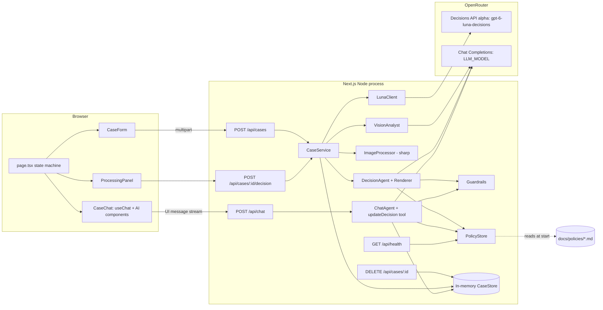
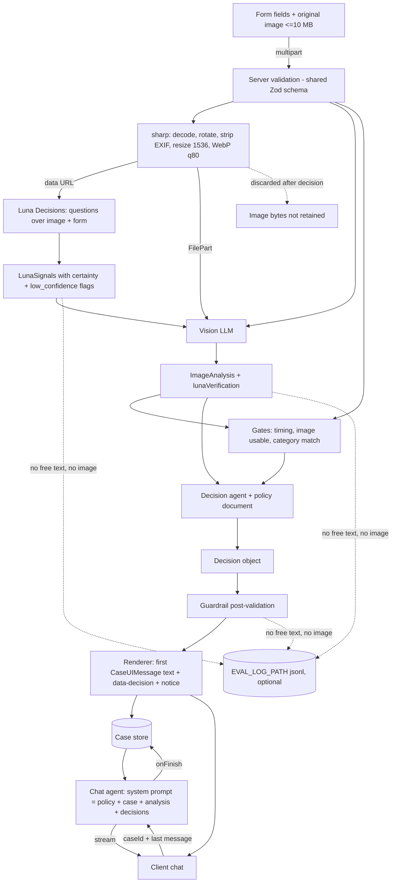
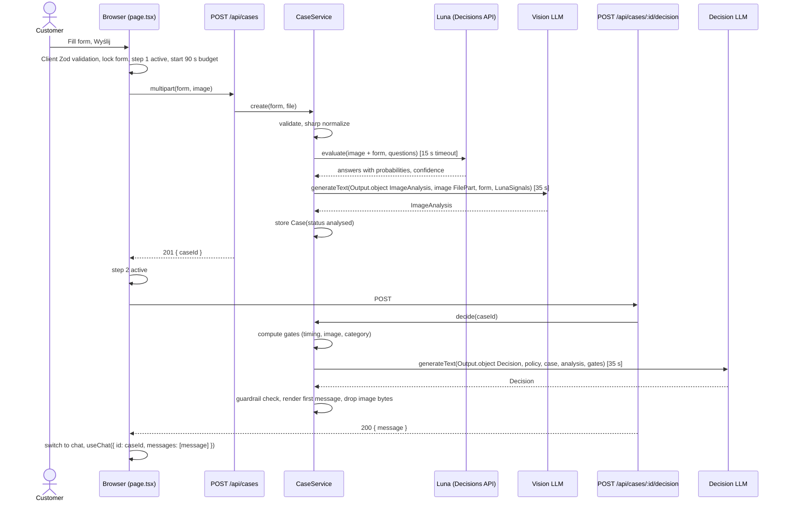
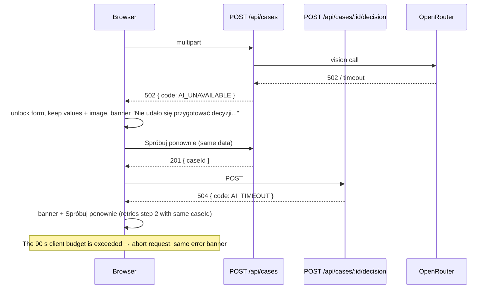
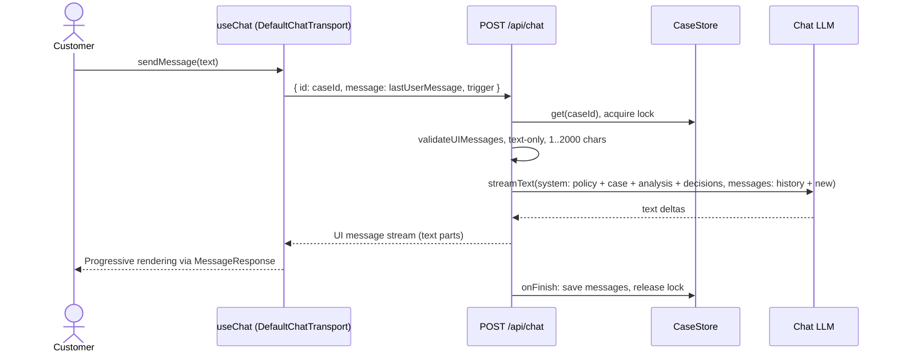
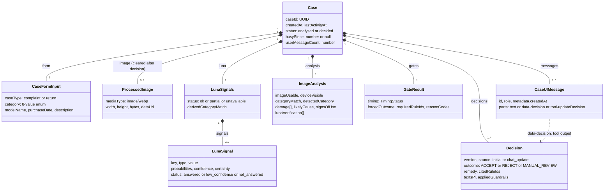
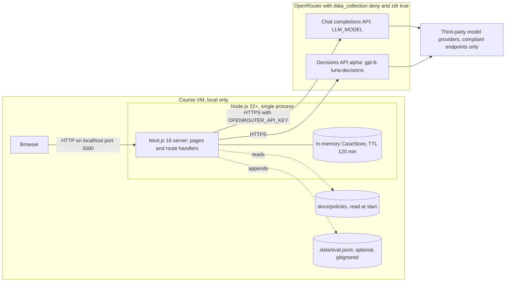

# ADR: Hardware Service Decision Copilot — Main Architecture

**Date:** 2026-11-25
**Status:** Accepted
**PRD:** [docs/PRD.md](../PRD.md)

---

## 1. Overview

This ADR set defines how to build the PoC described in the PRD. The product is an anonymous, Polish-language web app. The customer fills in a complaint/return form with one photo, gets a **preliminary decision** as the first chat message, then continues in a streaming chat.

The PRD defines *what* and *why*; these documents define *how*. Area ADRs:

| File | Area |
|---|---|
| `000-main-architecture.md` (this) | System, stack, project initialization, library evaluation, cross-cutting decisions, overall testing |
| [`001-ai-pipeline.md`](001-ai-pipeline.md) | Luna Decisions pre-check, vision analysis, decision agent, chat agent, prompts, guardrails |
| [`002-backend-api.md`](002-backend-api.md) | Route handlers, case store, image processing, validation, errors, timeouts |
| [`003-frontend.md`](003-frontend.md) | Screens, components, chat UI, client state, design tokens |

**Decision pipeline (one sentence):** form → server compresses image → **Luna Decisions** pre-check (calibrated probabilities per question) → **vision LLM** analysis that verifies Luna's signals → **reasoning LLM** decision with deterministic guardrails → first chat message → **streaming chat** with full case context held on the server.

### Decisions made with the user (2026-11-25)

| Topic | Decision | Source |
|---|---|---|
| Luna vs LLM | The LLM **always** makes the first decision. Luna's output is a signal for the LLM, and its confidence is logged for later evaluation of a bypass. | User |
| Case state | Server in-memory store keyed by `caseId`, with a TTL | User |
| Deployment | Local only (`npm run dev` / `npm run build && npm start`), one Node process | User |
| Framework | Next.js App Router, TypeScript strict | User brief |
| LLM access | OpenRouter, using `OPENROUTER_API_KEY` and `LLM_MODEL` from `.env.example` | User brief |
| Package manager and tests | npm, Vitest, Playwright | **Assumption** (question unanswered; recommended default) |
| Chat UI kit | shadcn/ui AI components (the successor to AI Elements) | **Assumption** (question unanswered) |
| Luna failure handling | Optional signal: a failed or refused Luna call never blocks the case | **Assumption** (question unanswered) |
| App location | Next.js project generated inside `app/` with `--src-dir` | **Assumption** (question unanswered) |

---

## 2. Technology Documentation References

Versions verified with `npm view` on 2026-11-25. Implementing agents must fetch current docs from these IDs and links before writing code (AGENTS.md: Context7 first).

| Library | Context7 ID or official docs | Version | Used for |
|---|---|---|---|
| AI SDK (core + UI) | `/vercel/ai` (indexes `main`, including the v7 migration guide) | `ai@^7` (7.0.181), `@ai-sdk/react@^4` (4.0.186) | `generateText` + `Output.object`, `streamText`, `useChat`, UI message streams, `ai/test` mocks |
| AI Elements / shadcn AI components | `/vercel/ai-elements`; successor docs <https://ui.shadcn.com/docs/ai-elements> | ai-elements 1.9.1 (registry deprecated end of Nov 2026) | Chat UI components (Conversation/Chat, Message, MessageResponse, Prompt Input) |
| Next.js | `/vercel/next.js/v16.4.5` | `next@16.4.6`, React 19.3 | App Router, route handlers, build |
| OpenRouter AI SDK provider | <https://openrouter.ai/docs/guides/community/vercel-ai-sdk>, npm README of `@openrouter/ai-sdk-provider` | `@openrouter/ai-sdk-provider@^3` (3.1.0; peer `ai ^7`, Node ≥ 22, ESM-only) | Chat models (`openrouter(modelId)`), Decisions models (`openrouter.evaluationModel(id)` + `experimental_evaluate`) |
| OpenRouter Decisions API (alpha) | <https://openrouter.ai/docs/guides/features/decisions.md>, <https://openrouter.ai/docs/guides/community/multimodal-decisions.md> | alpha (`/api/alpha/decisions`) | Luna Decisions pre-check |
| OpenRouter platform | <https://openrouter.ai/docs/api_reference/errors>, <https://openrouter.ai/docs/api_reference/limits>, <https://openrouter.ai/docs/guides/features/structured-outputs.md>, <https://openrouter.ai/docs/guides/overview/multimodal/image-understanding.md> | — | Error codes, structured outputs, image input |
| Streamdown | <https://streamdown.ai> | `streamdown@2.8.1` (installed with MessageResponse) | Streaming markdown rendering |
| shadcn/ui CLI | <https://ui.shadcn.com/docs/cli> | `shadcn@4.23.0` | UI primitives, theme variables |
| Tailwind CSS | <https://tailwindcss.com/docs> | 4.3.x (installed by create-next-app) | Styling, design tokens |
| sharp | <https://sharp.pixelplumbing.com> | `sharp@0.35.5` | Image validation, EXIF rotation, metadata stripping, resizing |
| Zod | <https://zod.dev> | `zod@^4` (provider peer: `^3.25.76 \|\| ^4.1.8`) | Shared schemas (form, model outputs, API contracts) |
| Vitest | <https://vitest.dev> | latest | Unit and integration tests |
| Playwright | <https://playwright.dev> | latest | E2E and manual QA |

---

## 3. System Architecture

### Architecture pattern

A **single Next.js App Router monolith**: React client components for the UI and Node.js route handlers for the backend, in one process. The server holds case state in memory. There is no database, no auth and no external storage. Every LLM call goes through OpenRouter.

### Repository structure

```
app/                          Next.js project (create-next-app, --src-dir)
  AGENTS.md                   Generated by create-next-app; nested, app-scoped agent rules
  README.md                   Course README content + dev/run instructions
  .env.example                Canonical list of app env vars (section 7)
  CLAUDE.md                   One line `@AGENTS.md` so Claude Code loads the app rules
  public/                     Static files (no Eurocash assets, PRD AC-45)
  src/
    app/                      App Router: layout, page, globals.css, api/ route handlers
    components/
      ui/                     shadcn primitives (generated)
      ai-elements/            Chat components from the shadcn AI registry (generated)
      case-form/              Form screen components
      case-chat/              Chat screen components (DecisionBlock, CaseSummaryPanel, ...)
    lib/
      shared/                 Code shared by client and server: zod schemas, enums, Polish UI strings, date rules
    server/                   Server-only modules (each file imports 'server-only')
      cases/                  Case store, case service
      image/                  Image processing
      ai/                     OpenRouter provider, Luna client, vision analyst, decision agent, chat agent, prompts/
      policies/               Policy loader and rule-ID index
      guardrails/             Deterministic decision rules
  scripts/                    Node helper scripts (fixture generation, OpenRouter capture, eval report)
  tests/
    unit/  component/  integration/  e2e/  fixtures/
docs/policies/                Policy documents (source of truth, read at server start)
assets/example-images/        Synthetic test photos used by integration/E2E tests
```

### Technology stack

| Layer | Technology | Reason |
|---|---|---|
| Runtime | Node.js ≥ 22 | Required by `@openrouter/ai-sdk-provider@3`. Next 16 requires ≥ 20.9. |
| Framework | Next.js 16 App Router, TypeScript strict | User requirement. Route handlers and React UI in one deployable. |
| UI | React 19, Tailwind CSS 4, shadcn/ui (Radix base), shadcn AI components | Components are copied into the repo, so they are fully restylable to the Eurocash tokens. Streaming markdown is supported out of the box. |
| AI orchestration | AI SDK v7 (`ai`, `@ai-sdk/react`) | One API for structured output, streaming and the chat UI protocol. Mock models make TDD possible. |
| LLM gateway | OpenRouter through `@openrouter/ai-sdk-provider@3` | User requirement. A native AI SDK v7 provider that also exposes the Decisions API. |
| Pre-check model | `openai/gpt-6-luna-decisions` (Decisions API, alpha) | User requirement. Returns calibrated probabilities and confidence per question. |
| Vision / decision / chat model | `LLM_MODEL` (default `openai/gpt-6-luna`), overridable per role | User requirement (`.env.example`) |
| Image processing | sharp | The de-facto Node image library, already an optional dependency of Next 16 |
| Validation | Zod 4 | One schema set for client, server and model outputs |
| State | In-memory `Map` on `globalThis` with TTL | User decision. No database in the PoC. |
| Tests | Vitest, `ai/test` `MockLanguageModelV4`, Playwright | AGENTS.md TDD rules. Playwright is already required for manual QA. |

---

## 4. Module Structure & Dependencies

Dependencies flow one way: `app (routes, pages)` → `components` / `server` → `lib/shared`. `server` never imports `components`, `components` never imports `server`, and `lib/shared` imports nothing from the project.

| Module | Responsibility | Depends on | Used by |
|---|---|---|---|
| `lib/shared/schemas` | Zod schemas and TS types: `CaseFormInput`, `ImageAnalysis`, `LunaSignals`, `Decision`, `CaseUIMessage`, API DTOs | zod | everything |
| `lib/shared/strings` | All Polish UI strings and error messages from the PRD, split into `common.ts` (shared and server messages), `form.ts` (form screen) and `chat.ts` (chat screen) | — | components, server (error messages) |
| `lib/shared/dates` | Pure date helpers: today in Europe/Warsaw, calendar-day difference, adding months with end-of-month clamping | — | schemas (date bounds), guardrails |
| `server/policies` | Loads `docs/policies/*.md` at startup, extracts rule IDs, provides the text and an ID set per case type | fs | ai, guardrails |
| `server/image` | Validates, normalizes and compresses the upload, and produces a data URL | sharp | cases service |
| `server/cases/store` | In-memory case store with TTL, a capacity cap and a per-case lock | — | cases service, chat route |
| `server/cases/service` | Orchestrates create → pre-check → analysis → decision; owns timeouts | image, ai, guardrails, store | route handlers |
| `server/ai/provider` | Creates the OpenRouter provider and model instances from env | `@openrouter/ai-sdk-provider` | ai/* |
| `server/ai/luna` | Decisions API questions and normalization into `LunaSignals` | provider, ai | cases service |
| `server/ai/vision` | Vision analysis with structured output | provider, ai, prompts | cases service |
| `server/ai/decision` | Decision agent with structured output, plus the first message renderer | provider, ai, prompts, policies | cases service |
| `server/ai/chat` | Chat system prompt, `updateDecision` tool, `streamText` | provider, ai, prompts, policies, guardrails | chat route |
| `server/guardrails` | Return/complaint timing status, deterministic gates and post-validation of decisions | lib/shared/dates, policies | decision, chat |
| `app/api/*` | HTTP layer only: parse, call service, map errors | server/cases, server/ai/chat | client |
| `components/*` | UI | lib/shared, `@ai-sdk/react` | `app/page.tsx` |

---

## 5. Data Models

All models are defined once as Zod schemas in `lib/shared/schemas`. Details are in 001 and 002.

| Model | Purpose | Key fields | Persistence |
|---|---|---|---|
| `CaseFormInput` | Validated form data | caseType (`complaint`\|`return`), category (8-value enum), modelName, purchaseDate (ISO `YYYY-MM-DD`), description | Server memory (inside `Case`) |
| `ProcessedImage` | Compressed image for the models | mediaType `image/webp`, width, height, bytes, dataUrl | Server memory until the decision is made, then discarded (only the analysis is kept) |
| `LunaSignals` | Normalized pre-check answers | per question: key, value, probabilities, confidence, certainty, status (`answered`\|`low_confidence`\|`not_answered`); overall status (`ok`\|`partial`\|`unavailable`) | `Case` |
| `ImageAnalysis` | Vision LLM output | imageUsable, unusableReason, deviceVisible, categoryMatch, detectedCategory, damage[], likelyCause, signsOfUse, resellableAsNew, observationsPl, lunaVerification[] | `Case` |
| `TimingStatus` | Deterministic deadline check | status (`within`\|`buffer`\|`outside`), daysSincePurchase, deadline date, applicable rule ID | Computed |
| `Decision` | Preliminary decision | outcome (`ACCEPT`\|`REJECT`\|`MANUAL_REVIEW`), remedy, citedRuleIds, photoSummaryPl, justificationPl, nextStepsPl[], clarifyingQuestionsPl[], source (`initial`\|`chat_update`), version, appliedGuardrails[] | `Case.decisions[]` |
| `CaseUIMessage` | AI SDK `UIMessage` typed with metadata and a `data-decision` part and a `tool-updateDecision` part | id, role, parts, metadata (createdAt) | `Case.messages[]` |
| `Case` | Aggregate | caseId (UUID v4), createdAt, lastActivityAt, form, image (transient), luna, analysis, timing, decisions[], messages[], status (`analysed`\|`decided`), busySince (lock timestamp or null) | In-memory store. TTL 120 min after last activity. Max 500 cases (oldest evicted). Lost on restart. |

---

## 6. API / Interface Contracts

Full contracts are in [002-backend-api.md](002-backend-api.md). Summary of how the PRD flow maps to endpoints and components:

| PRD step | Client component | Endpoint | Server modules | Response |
|---|---|---|---|---|
| Form submit → "Analizuję zdjęcie…" | `CaseForm` → `ProcessingPanel` step 1 | `POST /api/cases` (multipart) | image → luna → vision | `201 { caseId }` |
| "Przygotowuję decyzję…" | `ProcessingPanel` step 2 | `POST /api/cases/{caseId}/decision` | guardrails → decision agent → renderer | `200 { message: CaseUIMessage }` |
| First chat bubble | `CaseChat` seeds `useChat({ id: caseId, messages: [message] })` | — | — | — |
| Chat message | `PromptInput` → `useChat.sendMessage` | `POST /api/chat` (UI message stream) | chat agent (+ `updateDecision` tool) | Streamed `CaseUIMessage` |
| New case | `NewCaseDialog` | `DELETE /api/cases/{caseId}` | store | `204` |
| Readiness (tests) | — | `GET /api/health` | policies, env | `200 { status, policies }` |

---

## 7. Environment Variables

Next.js loads env files from `app/`. `app/.env.example` is the canonical list. The root `.env.example` keeps `OPENROUTER_API_KEY` and `LLM_MODEL` and gets one comment line pointing to `app/.env.example`. The real key goes in `app/.env.local`, which is gitignored.

| Variable | Purpose | Required | Example value |
|---|---|---|---|
| `OPENROUTER_API_KEY` | OpenRouter auth, server-side only | Yes | `sk-or-v1-…` |
| `LLM_MODEL` | Default chat-completions model for vision, decision and chat | Yes | `openai/gpt-6-luna` |
| `VISION_MODEL` | Override for image analysis. Must accept image input. | No (defaults to `LLM_MODEL`) | `openai/gpt-6-luna` |
| `DECISION_MODEL` | Override for the decision agent | No (defaults to `LLM_MODEL`) | `openai/gpt-6-luna` |
| `CHAT_MODEL` | Override for the chat agent | No (defaults to `LLM_MODEL`) | `openai/gpt-6-luna` |
| `DECISIONS_MODEL` | Luna Decisions model id (Decisions API) | No (default shown) | `openai/gpt-6-luna-decisions` |
| `DECISIONS_ENABLED` | Turns the Luna pre-check on or off | No (default `true`) | `true` |
| `DECISIONS_CONFIDENCE_THRESHOLD` | Certainty below which a Luna answer is flagged `low_confidence` | No (default `0.80`) | `0.80` |
| `POLICIES_DIR` | Directory with `return-terms.md` and `complaint-terms.md` | No (defaults to `../docs/policies` relative to `app/`) | `../docs/policies` |
| `CASE_TTL_MINUTES` | Inactivity time after which a case is deleted | No (default `120`) | `120` |
| `EVAL_LOG_PATH` | If set, appends one JSON line per case with Luna and LLM signals and the outcome (no image, no free text) for evaluating a bypass | No (unset = off) | `./.data/eval.jsonl` |

All variables are read and validated with Zod once at server start, in `server/env.ts`. Missing or invalid required values stop startup with a clear message. Nothing is exposed as `NEXT_PUBLIC_*`.

---

## 8. Technical Decisions

### TD-01 AI SDK v7 + OpenRouter provider as the AI layer
**Status:** Accepted
**Date:** 2026-11-25
**Context:** The PRD needs structured image analysis, a structured decision, a streaming chat with history, and testable AI calls. The user asked to compare the AI SDK with OpenRouter's Responses API and the OpenRouter provider.
**Decision:** Use **AI SDK v7** (`ai@^7`, `@ai-sdk/react@^4`) with **`@openrouter/ai-sdk-provider@^3`**:
- `generateText` + `Output.object` for structured outputs.
- `streamText` + `toUIMessageStream` + `createUIMessageStreamResponse` for the chat. The deprecated `result.toUIMessageStreamResponse()` is not used.
- `useChat` + `DefaultChatTransport` on the client.

The provider is the only package that natively connects AI SDK v7 to OpenRouter, including the Decisions API (`evaluationModel` + `experimental_evaluate`).
**Rejected alternatives:**
- OpenRouter Responses API called directly: it is stateless (the full history is sent every call, and `store`/`previous_response_id` are rejected). We would hand-write SSE parsing, the client streaming protocol, structured-output validation and test mocks, which the AI SDK already provides.
- Raw Chat Completions with `fetch`: the same drawbacks.
- AI SDK v6 (`ai-v6` tag): v7 is `latest`, and the provider v3 and assistant-ui v7 packages both target it.
**Consequences:**
- (+) One streaming protocol from server to `useChat`, typed `UIMessage` parts, `MockLanguageModelV4` for tests.
- (+) Switching models means changing an env value.
- (-) v7 renamed several APIs (`FilePart` with `mediaType: 'image'`, standalone `toUIMessageStream`, `generateObject` deprecated). Agents must follow `/vercel/ai` docs, not v5/v6 examples.
- (-) Node ≥ 22 and an ESM-only provider.
**Review trigger:** AI SDK v8 is released, or the provider drops `ai@^7` support.

### TD-02 Build on create-next-app + shadcn, not the Chatbot template (Chat SDK)
**Status:** Accepted
**Date:** 2026-11-25
**Context:** The user asked to evaluate <https://chat-sdk.dev/>.
**Decision:** Start from `create-next-app` and add shadcn/ui and the shadcn AI chat components.
**Rejected alternatives:**
- chat-sdk.dev: it is now a TypeScript SDK for chat **bots** on Slack, Teams, WhatsApp and similar platforms, not a web-chat template. It does not fit a browser form→chat flow.
- vercel/chatbot ("Chatbot", formerly AI Chatbot, Apache-2.0): it depends on Auth.js, Postgres/Drizzle (migrations run in `build`), Vercel Blob, Redis resumable streams, AI Gateway, artifacts and chat history. For an anonymous, DB-less Polish PoC, removing all that costs more than adding the few components we need, and leaves dead code behind.
- assistant-ui (`@assistant-ui/ai-sdk` for v7, `useChatRuntime`): a good runtime, but it adds a state layer over `useChat`. Our custom decision block, the case id in every request, and the per-message retry would need custom runtime adapters. Kept as the fallback if the shadcn AI components prove insufficient.
**Consequences:**
- (+) Minimal surface. Every line maps to a PRD requirement.
- (+) Components live in the repo and are styled with our tokens.
- (-) Chat UX details (auto-scroll, retry state) are written by us on top of the components.
**Review trigger:** The product adds accounts, persisted chat history or file attachments in chat. Then re-evaluate vercel/chatbot.

### TD-03 shadcn AI components (successor of AI Elements) for the chat UI
**Status:** Accepted (assumption, user did not answer)
**Date:** 2026-11-25
**Context:** We need chat components with streaming markdown. AI Elements announces it "will be deprecated at the end of November 2026" and moves to shadcn/ui (conversation→Chat, message→Message, prompt-input→Prompt Input).
**Decision:** Install the chat components from the shadcn/ui AI registry (<https://ui.shadcn.com/docs/ai-elements>). If a needed component is not yet published there on implementation day, install the AI Elements registry version (`npx ai-elements@latest add <component>`). The docs say existing copies keep working and need no migration. Components: Chat/Conversation, Message + MessageContent + MessageResponse (Streamdown), Prompt Input (textarea + submit, **no attachments**).
**Rejected alternatives:** assistant-ui (see TD-02). Hand-written components: they would reimplement streaming markdown and auto-scroll.
**Consequences:** (+) Out-of-the-box streaming markdown. (-) Component names may differ between the two registries, so the implementing agent must check the installed source.
**Review trigger:** The shadcn AI registry changes component APIs used here.

### TD-04 Server-side in-memory case store
**Status:** Accepted (user decision)
**Date:** 2026-11-25
**Context:** The chat agent needs the form data, analysis and decision on every turn (PRD AC-34), with no database. Sending context from the client would let customers edit the decision (prompt and context tampering).
**Decision:**
- Store `Case` objects in a `Map` kept on `globalThis`, so it survives dev hot reload.
- TTL is 120 min after the last activity, with a sweep every 5 min.
- At most 500 cases; the least-recently-active case is evicted first.
- The client sends only `caseId` and its newest message.
**Rejected alternatives:** HMAC-signed client context (stateless, more complex). Unsigned client context (tamperable). SQLite (planned for later, out of PoC scope).
**Consequences:**
- (+) Tamper-proof context and small requests.
- (-) Needs exactly one long-running Node process. A restart loses all cases (the client shows "session expired", see 002).
- (-) Not deployable to serverless as is.
**Review trigger:** Deploying to Vercel or multiple instances, or adding the PRD's "save sessions" feature. Then replace the store implementation (the same interface) with SQLite.

### TD-05 Luna Decisions as an optional pre-check signal; the LLM always decides
**Status:** Accepted (user decision). The bypass is **Proposed** for later.
**Date:** 2026-11-25
**Context:** The user wants a decision model (Luna) to check category match, damage and condition from the photo and form before the LLM. The LLM should verify Luna's output. A bypass of the LLM at high confidence is to be considered.
**Decision:**
- Luna runs first through the Decisions API (alpha). Its answers are normalized into `LunaSignals` with a `certainty` per question.
- Answers below `DECISIONS_CONFIDENCE_THRESHOLD` (0.80) are flagged `low_confidence`. The vision LLM must verify every signal explicitly, flagged ones in particular.
- Luna failure, timeout or refusal → `not_answered`, and the pipeline continues.
- The bypass is **not** built. Every case writes an evaluation record (`EVAL_LOG_PATH`) so agreement between Luna and the LLM can be measured first.

Details are in 001.
**Rejected alternatives:**
- Confidence-gated bypass now: no data yet shows Luna is accurate enough, and the Decisions API is alpha.
- Shadow mode with a separate full LLM run: higher cost, and the always-LLM design already produces both outputs.
- Luna as a required step: it would make an alpha API a single point of failure.
**Consequences:**
- (+) Luna's calibrated probabilities feed the LLM, and the evaluation data enables a later bypass decision.
- (-) Adds up to 15 s of latency per case.
- (-) Alpha API shape may change. It is isolated behind the `LunaClient` interface.
**Review trigger:** At least 200 evaluated cases show ≥ 95 % agreement between Luna and the LLM on category match, damage and condition when Luna certainty ≥ 0.90. Then write a new ADR for a gated bypass.

### TD-06 Two-request pipeline before the chat; no streaming for the first message
**Status:** Accepted
**Date:** 2026-11-25
**Context:** The PRD shows a two-step progress indicator (AC-15, 9.2), a 90 s limit (AC-28), deterministic sections and a notice in the first message (AC-29, AC-41), and guaranteed rule citations (AC-23).
**Decision:**
- `POST /api/cases` performs the upload, compression, Luna call and vision analysis.
- `POST /api/cases/{id}/decision` produces the decision as a **structured object**. Code validates it with the guardrails and renders the first message from a template.
- The client shows step 1 while the first request runs and step 2 during the second, with one 90 s budget overall.
**Rejected alternatives:**
- One streaming request with transient progress data parts: a step can't be retried on its own, and the client logic gets more complex.
- Streaming the decision as free text: it can't be validated before display and the notice isn't guaranteed.
**Consequences:**
- (+) Each step is retriable and testable, and the first message is guaranteed to match AC-29 and AC-41.
- (-) The first message appears at once instead of token by token.
**Review trigger:** Users find the wait too long (p50 > 30 s).

### TD-07 Deterministic guardrails around LLM decisions
**Status:** Accepted
**Date:** 2026-11-25
**Context:** AC-24 – AC-27 and the agent constraints must hold every time, and an LLM cannot guarantee that.
**Decision:**
- Timing status, the image-quality gate and the category-mismatch gate are computed **before** the decision call. They are passed in as fixed constraints.
- After the call, code enforces: allowed outcome, allowed remedy for each outcome and case type, cited rule IDs that exist in the policy, and no REJECT when the cause is unclear.
- A violation triggers one corrective retry, then a template-based MANUAL_REVIEW fallback.

Details are in 001.
**Rejected alternatives:** Prompt-only rules (not verifiable). Fully rule-based decisions (can't interpret photos and descriptions).
**Consequences:** (+) The ACs are testable without a live model. (-) The guardrail and prompt rules need to be kept in sync.
**Review trigger:** The policy documents gain rules that change the timing windows or outcomes.

### TD-08 Next.js project initialized inside `app/` with `--src-dir`
**Status:** Accepted (assumption)
**Date:** 2026-11-25
**Context:** The repository keeps the application in `app/` (AGENTS.md layout). `create-next-app` rejects non-empty directories (verified: a directory with only `README.md` fails). A Next.js App Router folder named `app` inside `app/` would be confusing.
**Decision:** Follow the initialization procedure in section 11. `--src-dir` gives `app/src/app/…`.
**Rejected alternatives:** Repository root (collides with the root README/AGENTS and mixes course files with the app).
**Consequences:**
- (+) Clean separation.
- (+) The generated `app/AGENTS.md` becomes a scoped instruction file.
- (-) All npm commands run with `app/` as the working directory.
- (-) Policies are read from `../docs/policies`.
**Review trigger:** The app moves to its own repository.

### TD-09 Image normalization with sharp before any model call
**Status:** Accepted
**Date:** 2026-11-25
**Context:** The PRD asks the backend to compress images. Phone photos carry EXIF data (including GPS) and are 3–12 MB.
**Decision:**
- Verify the real format by decoding (JPEG/PNG/WebP only) and limit the input to 40 megapixels.
- Auto-rotate from EXIF, then strip all metadata.
- Resize so the longer side is at most **1536 px** (no upscaling) and encode as WebP at quality 80.
- Send the same bytes to Luna and the vision LLM as a `data:image/webp;base64,…` URL / `FilePart`.

Details are in 002.
**Rejected alternatives:** Client-side compression (an untrusted client and a duplicated implementation). Sending originals (cost, latency, privacy).
**Consequences:** (+) Smaller payloads (~150–400 KB), no location metadata sent to third parties. (-) sharp is a native dependency.
**Review trigger:** A vision model's documentation recommends a different resolution.

---

### TD-10 Privacy settings for every OpenRouter call
**Status:** Accepted (user decision 2026-11-26, option a)
**Date:** 2026-11-26
**Context:**
- Customer photos and descriptions can contain personal data (PRD §8, GDPR).
- OpenRouter routes requests to third-party providers. By default it allows providers that may collect or retain prompts (`provider.data_collection` defaults to `allow`).
**Decision:**
- Every OpenRouter request sets `provider.data_collection: "deny"` and `provider.zdr: true` (zero data retention), so only endpoints that neither train on nor retain the data serve it. This covers the vision, decision and chat calls and the Decisions API call.
- The settings are applied in one place, the provider factory in `server/ai/provider`, for chat models. The Luna client applies them in its request.
- They are not configurable by environment variables, because the PoC must not run without them.
- No EU-only host for the PoC: `eu.openrouter.ai` requires a Business plan.
- T04 checks that at least one compliant endpoint serves each configured model. If none does, the case is stopped and escalated to the human; it does not fall back to permissive settings.
**Rejected alternatives:**
- Only `data_collection: "deny"`: providers could still retain prompts temporarily.
- No restrictions, relying on synthetic data: real photos could be uploaded during demos.
**Consequences:**
- (+) No training on or retention of customer data by the serving providers.
- (-) Fewer eligible providers, so higher latency or cost and possible 503 "no provider meets your routing requirements". Model choice may need to change after T04.
**Review trigger:** moving to production (add EU residency and a data processing agreement), or T04 finding no compliant endpoint for a configured model.

## 9. Diagrams

### 9.1 Architecture / Component Diagram



### 9.2 Data Flow Diagram



### 9.3 Sequence Diagrams

#### Form submission, analysis and decision (happy path)



#### Error path: AI failure or timeout during processing



#### Streaming chat turn



See 001 for the `updateDecision` tool flow and 002 for chat error handling.

### 9.4 Data Model (class diagram)

Conceptual model of the in-memory case aggregate (section 5). Field lists are abbreviated; ADR-001 §4 and ADR-002 §4.3 are authoritative.



### 9.5 Deployment Diagram

PoC deployment (TD-04, ADR-002 TD-204): one local Node.js process and no database; every model call leaves through OpenRouter with the TD-10 privacy settings.



---

## 10. Testing Strategy

### Philosophy

TDD per AGENTS.md: write tests from the PRD acceptance criteria and these ADRs first, see them fail, then implement. **Capture policy:** mocked external responses come only from real recorded calls, or from real captures with listed edits. No response shape is taken from documentation, and anything that can't be captured safely is reported as a missing prerequisite. The plan's §4 defines the capture list and the real-stack coverage for E2E and manual tests. Deterministic logic (dates, guardrails, schemas, image processing, rendering) is fully unit-tested. AI calls are integration-tested with `MockLanguageModelV4` and a fake `LunaClient`. Mocks are derived from **recorded real responses**: one real Luna response and one real structured output per role, captured once with synthetic images from `assets/example-images/` and stored in `tests/fixtures/recorded/` with date, model id and request (AGENTS.md rule). E2E uses the real stack and the real OpenRouter, without mocks.

### Test layers

| Layer | Type | Scope | Tools |
|---|---|---|---|
| Unit | Pure functions and components | dates, guardrails, policy parser, schemas, LunaSignals normalization, renderer, image processor (real sharp, fixture files), form component validation | Vitest, @testing-library/react, jsdom |
| Integration | Route handlers in process | `/api/cases`, `/decision`, `/api/chat` with mock models (`MockLanguageModelV4`, `simulateReadableStream`) and a fake LunaClient; real store, real sharp | Vitest (node environment) |
| E2E | Real browser + real server + real OpenRouter | Main PRD flows with `assets/example-images` | Playwright (`@playwright/test`), Playwright CLI for manual QA |

### Key test scenarios (cross-cutting; area-specific ones are in 001–003)

| Scenario | Input | Expected |
|---|---|---|
| Happy return | Laptop photo, Zwrot, purchase today − 5 days | First message has the decision block, a cited R-rule and the notice. Chat replies stream. |
| Happy complaint | Phone photo, Reklamacja, today − 400 days, 40-char description | Decision with a complaint remedy, C-rule cited |
| Return outside period | today − 30 days | REJECT citing R-2.4, regardless of the model output |
| Return in buffer | today − 18 days | MANUAL_REVIEW citing R-2.3 |
| Category mismatch | Phone photo, category Laptop | MANUAL_REVIEW, the message names the mismatch |
| Luna unavailable | Fake LunaClient throws | Case still decided, `luna.status = unavailable` |
| AI failure | Vision mock throws a 502-like error | `502 AI_UNAVAILABLE`, the form keeps its values |
| Session expired | Chat with an unknown caseId | `404 CASE_NOT_FOUND`, the UI shows the expiry message and the New case action |

### Technical acceptance criteria

- **TAC-01** `npm run typecheck` (`tsc --noEmit`) passes with `strict: true`, `noUncheckedIndexedAccess: true`. There is no `any` in `src/server` and `src/lib`. ESLint has no errors.
- **TAC-02** `npm test` runs all unit and integration tests with zero network calls (enforced by a test setup that fails on any outgoing `fetch` to openrouter.ai).
- **TAC-03** `npm run build` succeeds, and `npm start` serves `/` and `GET /api/health` returns `200` with both policy documents loaded.
- **TAC-04** `OPENROUTER_API_KEY` never appears in the client bundle (`.next/static` grep returns nothing) or in any API response.
- **TAC-05** No route handler uses the edge runtime. All `server/*` modules import `server-only`.
- **TAC-06** The Playwright E2E suite passes the happy return, happy complaint and validation scenarios against the real stack.
- **TAC-07** Deprecated AI SDK APIs are not used: no `generateObject`, `streamObject`, `result.toUIMessageStreamResponse()`, or `{ type: 'image' }` content parts.

---

## 11. Project Initialization (from the empty `app/` folder)

Run these in order from the repository root, then verify each step. Check flags with `--help` if any are rejected. Flags were verified with create-next-app 16.4.6 and shadcn 4.23.0 on 2026-11-25.

1. **Prerequisites:** `node -v` must print ≥ 22. Use `nvm install 22` or an equivalent if it doesn't.
2. **Empty the target:** move `app/README.md` to the scratchpad. `create-next-app` refuses any existing file.
3. **Scaffold:** `npx create-next-app@latest app --ts --tailwind --eslint --app --src-dir --import-alias "@/*" --use-npm --yes --disable-git`. Turbopack is the default; there is no `--turbopack` flag. The generated `tsconfig.json` already has `"strict": true`.
4. **Restore the README:** merge the course README content back into `app/README.md`, followed by the generated run instructions.
5. **Keep `app/AGENTS.md`:** it is generated with Next.js agent rules. Add `app/CLAUDE.md` containing the single line `@AGENTS.md`, because Claude Code reads `CLAUDE.md` while OpenCode and Codex read `AGENTS.md`. Skip this if create-next-app already generated an equivalent `CLAUDE.md`. Add a short "Project rules" section that points to `docs/PRD.md` and `docs/ADR/`, names the commands from step 9, and gives the `src/server` vs `src/components` boundary.
6. **Tighten TypeScript:** add `noUncheckedIndexedAccess`, `noImplicitOverride` and `noFallthroughCasesInSwitch` to `app/tsconfig.json`.
7. **shadcn:**
   - Run `npx shadcn@latest init -t next -b radix` with `app/` as the working directory.
   - Add the primitives: button, input, textarea, select, radio-group, label, alert, alert-dialog, badge, card, collapsible, dialog.
   - Then add the AI chat components (TD-03): conversation/chat, message, prompt-input.
   - Add the Streamdown `@source` line to `globals.css` as the component docs require.
8. **Dependencies** (in `app/`):
   - Runtime: `ai@^7`, `@ai-sdk/react@^4`, `@openrouter/ai-sdk-provider@^3`, `zod@^4`, `sharp@^0.35`, `server-only`.
   - Dev: `vitest`, `@vitejs/plugin-react`, `jsdom`, `@testing-library/react`, `@testing-library/user-event`, `@playwright/test`.
   - Then run `npx playwright install chromium`.
9. **Scripts** in `app/package.json`:
   - `dev`, `build`, `start` (generated)
   - `lint` = `eslint`
   - `typecheck` = `tsc --noEmit`
   - `test` = `vitest run`
   - `test:watch` = `vitest`
   - `test:e2e` = `playwright test`
10. **Env:** create `app/.env.example` (section 7). Copy it to `app/.env.local` and fill in the key. Confirm that `.env.local` is gitignored, and add `.data/` (the default `EVAL_LOG_PATH` folder) to `app/.gitignore`.
11. **Assets:** do **not** copy the Eurocash logos or favicon (PRD AC-45). Create a neutral favicon, an SVG with the letters "SC" in `brand.primary` on white, as `app/src/app/icon.svg`. Map `assets/design-tokens.json` to CSS variables in `globals.css` (see 003).
12. **Verify:** run `npm run typecheck && npm run lint && npm test && npm run build`. Then start the app with `npm run dev` and open `/`. Record build, test and startup as separate results (AGENTS.md).
13. **Pre-implementation check:** confirm the model metadata that could not be verified on 2026-11-25. In a browser or with an approved command, query `https://openrouter.ai/api/v1/models` for `openai/gpt-6-luna`; its `input_modalities` must include `image` and its `supported_parameters` should include `response_format`/`structured_outputs`. Also query `?output_modalities=decisions` for `openai/gpt-6-luna-decisions`. If `gpt-6-luna` has no image input, set `VISION_MODEL` to an image-capable model and record the change in this ADR.

---

## 12. Open Questions and Unverified Facts

- `openai/gpt-6-luna-decisions` model page returned 404 and the models endpoint could not be queried (fetch denied). Its existence comes from OpenRouter's multimodal-decisions guide. Pricing, context and limits are unknown, which is why step 13 is required.
- `openai/gpt-6-luna` image input and `structured_outputs` support were not confirmed (only `response_format` is listed on its page).
- The exact shadcn AI registry component names after the AI Elements migration need checking on implementation day.
- `experimental_evaluate` and `/api/alpha/decisions` are alpha and may change. Any change stays inside `server/ai/luna`.
- The four "assumption" decisions in section 1 can be changed by the user before implementation without affecting the rest of the architecture.
