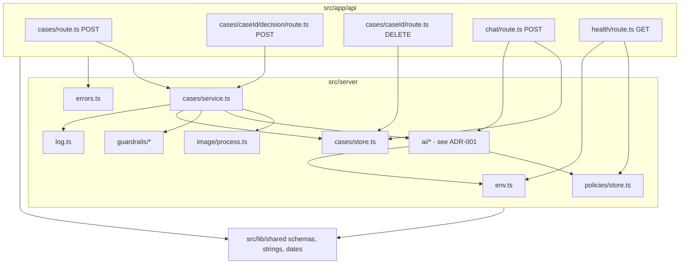
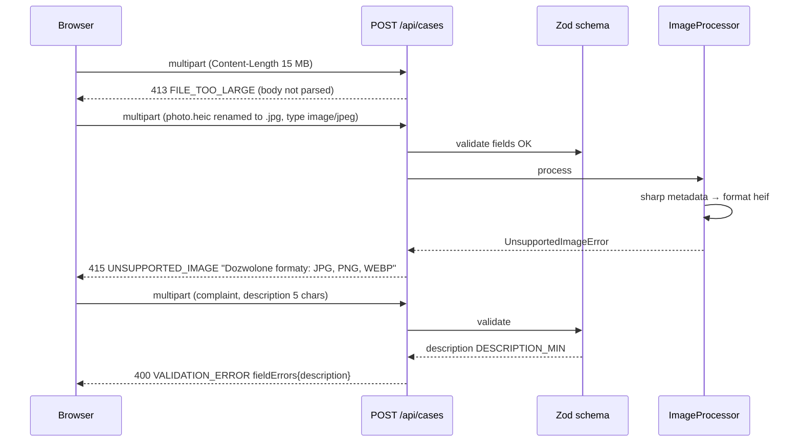
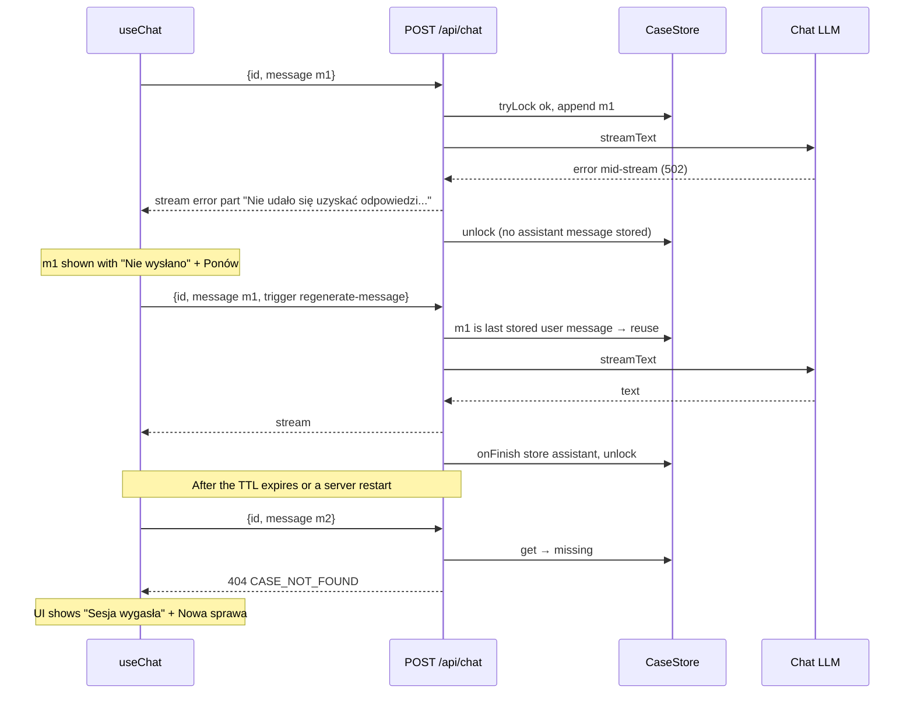

# ADR-002: Backend API, Case Store and Image Processing

**Date:** 2026-11-25
**Status:** Accepted
**Relates to:** `docs/ADR/000-main-architecture.md`, `docs/ADR/001-ai-pipeline.md`, PRD sections 4.6, 4.7, 6 (AC-04 – AC-11, AC-28, AC-32, AC-35 – AC-40), 8

---

## 1. Scope

This ADR covers:
- the Next.js route handlers and their HTTP contracts,
- server-side validation,
- the in-memory case store,
- image processing,
- policy loading, environment loading,
- error mapping, concurrency, logging and security.

Model prompts and decision logic are in 001. UI behaviour is in 003.

---

## 2. Technology Documentation References

| Library | Context7 ID or official docs | Used for |
|---|---|---|
| Next.js 16 | `/vercel/next.js/v16.4.5` (route handlers, route segment config) | Route handlers in `src/app/api/**/route.ts`, `runtime = 'nodejs'` (`edge` is deprecated) |
| AI SDK v7 | `/vercel/ai` (`04-ai-sdk-ui/03-chatbot-message-persistence.mdx`, `07-reference/02-ai-sdk-ui/01-use-chat.mdx`) | `validateUIMessages`, `toUIMessageStream`, `createUIMessageStreamResponse`, sending only the last message |
| sharp | <https://sharp.pixelplumbing.com/api-constructor>, <https://sharp.pixelplumbing.com/api-resize>, <https://sharp.pixelplumbing.com/api-output> | Decode, auto-orient, resize, WebP output, metadata stripping |
| Zod 4 | <https://zod.dev> | Request and env validation |
| OpenRouter errors | <https://openrouter.ai/docs/api_reference/errors> | Status code mapping |

**Verified on 2026-11-25:**
- App Router route handlers have **no built-in body size limit option**. `experimental.proxyClientMaxBodySize` (default 10 MB) applies only when `proxy.ts` is used, and it truncates rather than rejects. So the size limit is enforced in the handler.
- `next@16.4.6` lists `sharp@^0.35.5` only as an optional dependency, so `sharp` must be an explicit dependency.

---

## 3. Component Design

### 3.1 Layers

| Layer | Location | Responsibility |
|---|---|---|
| Route handlers | `src/app/api/**/route.ts` | Parse the HTTP input, call one service method, map domain errors to HTTP. No business logic. Every handler sets `runtime = 'nodejs'` and `dynamic = 'force-dynamic'`. |
| CaseService | `src/server/cases/service.ts` | Orchestrates the stages in 001, enforces time budgets, updates the store, writes the eval log |
| CaseStore | `src/server/cases/store.ts` | In-memory persistence with TTL, capacity limit and per-case lock |
| ImageProcessor | `src/server/image/process.ts` | Validates and normalizes the uploaded image |
| PolicyStore | `src/server/policies/store.ts` | Loads and indexes the policy documents once |
| Env | `src/server/env.ts` | Validates environment variables once (000 section 7) |
| Errors | `src/server/errors.ts` | Domain error classes and the error → HTTP mapping table (section 5.6) |
| Logger | `src/server/log.ts` | Structured JSON lines to stdout |

### 3.2 Case store

- **Storage:** a `Map<string, Case>` kept on `globalThis` (key `__hsdcCaseStore`) so that dev hot module reload doesn't reset it.
- **Interface:** `create(case)`, `get(caseId)`, `update(caseId, mutator)`, `delete(caseId)`, `tryLock(caseId)`, `unlock(caseId)`, `size()`.
- **TTL:** a case expires `CASE_TTL_MINUTES` (default 120) after `lastActivityAt`. `get` treats an expired case as missing and deletes it. A sweep runs every 5 minutes; start it lazily on first use and `unref()` the timer.
- **Capacity:** at most 500 cases. `create` on a full store evicts the case with the oldest `lastActivityAt`.
- **Lock:** a `busySince` timestamp per case.
  - `tryLock` fails when another request holds the lock and it is younger than 120 s.
  - A lock older than that is treated as stale and taken over.
  - Handlers release the lock in `finally` or in the stream's `onFinish`/`onError`/abort callbacks.
- **Image retention:** `Case.image` (the processed bytes) is set at creation and cleared right after the decision is stored. The original upload is never kept.
- **Future replacement:** the interface is the seam for the planned SQLite persistence (PRD Out of Scope).

### 3.3 Image processing pipeline

These steps follow TD-09, in this order. Any failure stops the pipeline with the stated error.

| # | Step | Rule | Error |
|---|---|---|---|
| 1 | Size check | `file.size ≤ 10 485 760` bytes (10 MiB). Also reject early when `Content-Length > 11 534 336`, before parsing the multipart body. | `FILE_TOO_LARGE` (413) |
| 2 | Declared type | `file.type` is one of `image/jpeg`, `image/png`, `image/webp` | `UNSUPPORTED_IMAGE` (415) |
| 3 | Decode and sniff | Read metadata with sharp, using `limitInputPixels = 40 000 000`. The detected `format` must be `jpeg`, `png` or `webp`. Extensions and the declared type are not trusted. | `UNSUPPORTED_IMAGE` (415) for another format. `IMAGE_UNREADABLE` (422) for a corrupt file or one over the pixel limit. |
| 4 | Normalize | Auto-orient from EXIF. Use the first frame only (animated input). | — |
| 5 | Resize | `fit: inside`, max 1536 × 1536, `withoutEnlargement: true` | — |
| 6 | Encode | WebP, quality 80. Output metadata is stripped (sharp's default without `withMetadata` / `keepMetadata`). | — |
| 7 | Produce | `ProcessedImage { mediaType: 'image/webp', width, height, bytes: Buffer, dataUrl }` | — |

HEIC is rejected at step 2 or 3 with the PRD message "Dozwolone formaty: JPG, PNG, WEBP" (AC-10).

### 3.4 Policy loading

- **Directory:** `POLICIES_DIR` (optional env), defaulting to `path.resolve(process.cwd(), '..', 'docs', 'policies')`. npm scripts run with `app/` as the working directory.
- **Files:** `return-terms.md` → case type `return`; `complaint-terms.md` → case type `complaint`.
- **Rule IDs:** extracted with the pattern `**R-n.n**` / `**C-n.n**` (bold rule markers in the documents).
- **Startup checks** (loaded once, cached): the return document has ≥ 10 `R-` IDs and no `C-` IDs; the complaint document has ≥ 10 `C-` IDs and no `R-` IDs. Otherwise startup fails with a clear error.
- `GET /api/health` reports the rule counts.

### 3.5 Time budgets (server side)

| Request | Budget | Composition |
|---|---|---|
| `POST /api/cases` | 52 s | image ≤ 2 s, Luna ≤ 15 s, vision ≤ 35 s |
| `POST /api/cases/{id}/decision` | 35 s | First attempt up to 25 s. The corrective retry runs only if ≥ 10 s of budget remain; otherwise the template fallback is used (001 §3.5). |
| `POST /api/chat` | 60 s total, first chunk ≤ 20 s | AI SDK v7 `timeout` option |

The client enforces the PRD's overall 90 s limit across both pre-chat requests (003). Every model call receives `request.signal`, so a closed tab or a client abort cancels upstream work.

---

## 4. Data Structures

### 4.1 Request DTOs

**`CaseFormInput`** is the shared Zod schema used by both client and server. Strings are trimmed before validation.

| Field | Type | Rule | Error code → Polish message (PRD) |
|---|---|---|---|
| `caseType` | `complaint` \| `return` | required | `REQUIRED` → "Wybierz rodzaj zgłoszenia" |
| `category` | `smartphone` \| `laptop` \| `tablet` \| `tv` \| `audio` \| `wearable` \| `camera` \| `small_appliance` | required | `REQUIRED` → "Wybierz kategorię sprzętu" |
| `modelName` | string | 2–100 chars, not only whitespace | `MODEL_NAME` → "Podaj nazwę lub model urządzenia" (AC-04) |
| `purchaseDate` | ISO `YYYY-MM-DD` | from 2000-01-01 to today (Europe/Warsaw) | `PURCHASE_DATE` → "Podaj prawidłową datę zakupu" (AC-05) |
| `description` | string | complaint: 20–2000 chars; return: 0–2000 | `DESCRIPTION_MIN` → "Opisz usterkę (min. 20 znaków)" (AC-06); `DESCRIPTION_MAX` → "Opis może mieć maks. 2000 znaków" |
| `image` | File | see 3.3 | `IMAGE_REQUIRED` → "Dodaj zdjęcie urządzenia"; `FILE_TOO_LARGE` → "Plik przekracza limit 10 MB" (AC-11); `UNSUPPORTED_IMAGE` → "Dozwolone formaty: JPG, PNG, WEBP" (AC-10); `IMAGE_UNREADABLE` → "Nie udało się odczytać zdjęcia. Wybierz inny plik." |

**Character counting:** lengths are counted in Unicode code points, the same way on client and server, so the "125 / 2000" counter matches the server rule.

**`ChatRequest`**: `id` (caseId, UUID), `message` (`CaseUIMessage`, role `user`, text parts only, combined text 1–2000 chars after trim), `trigger` (`submit-message` \| `regenerate-message`).

### 4.2 Response DTOs

| DTO | Fields |
|---|---|
| `CreateCaseResponse` | `caseId` (UUID) |
| `DecisionResponse` | `message` (`CaseUIMessage`: the first assistant message, see 001 §3.7) |
| `ErrorResponse` | `error: { code: string, messagePl: string, fieldErrors?: Record<field, code> }` |
| `HealthResponse` | `status: 'ok'`, `policies: { return: number, complaint: number }`, `decisionsEnabled: boolean`, `models: { vision, decision, chat, decisions }` (ids only, never keys) |

### 4.3 `Case` (stored)

| Field | Type | Notes |
|---|---|---|
| `caseId` | UUID v4 (`crypto.randomUUID`) | Not guessable. It is the only access token for the case. |
| `createdAt`, `lastActivityAt` | ISO datetime | `lastActivityAt` is updated on every request |
| `form` | `CaseFormInput` without the file | |
| `image` | `ProcessedImage` \| null | Cleared after the decision |
| `luna` | `LunaSignals` | |
| `analysis` | `ImageAnalysis` | |
| `gates` | `GateResult` | From the initial decision |
| `decisions` | `Decision[]` | v1 = initial; later versions from chat |
| `messages` | `CaseUIMessage[]` | First assistant message + the chat |
| `status` | `analysed` \| `decided` | |
| `busySince` | number \| null | Lock |
| `userMessageCount` | number | Max 40 |

---

## 5. Interface Contracts

All endpoints are same-origin, unauthenticated (PRD Out of Scope) and `runtime = 'nodejs'`. Errors always use `ErrorResponse`, and `messagePl` is safe to show to the customer.

### 5.1 `POST /api/cases`

- **Input:** `multipart/form-data` with the fields `caseType`, `category`, `modelName`, `purchaseDate`, `description` (may be empty) and `image` (one file).
- **Processing:**
  1. Run the early Content-Length check, then `request.formData()`.
  2. Validate with the Zod schema, then the image pipeline.
  3. Create the case.
  4. Run Luna (never fatal), then vision.
  5. Store the result with `status = analysed`.
- **Output:** `201 { caseId }`.
- **Errors:**
  - `400 VALIDATION_ERROR` with `fieldErrors`
  - `413 FILE_TOO_LARGE`
  - `415 UNSUPPORTED_IMAGE`
  - `422 IMAGE_UNREADABLE`
  - `502 AI_UNAVAILABLE`
  - `504 AI_TIMEOUT`
  - `500 INTERNAL`

  If the vision step fails, the case is deleted, so no half-analysed cases are left.
- **Notes:** this is not idempotent. The client's "Spróbuj ponownie" after a step-1 failure creates a new case (AC-40: the same form data is resent from client state).

### 5.2 `POST /api/cases/{caseId}/decision`

- **Input:** none (the path parameter only).
- **Processing:**
  1. `tryLock`.
  2. If `status = decided`, return the stored first message (idempotent).
  3. Otherwise run gates → decision agent → renderer.
  4. Store the decision v1 and the message, set `status = decided`, clear the image.
  5. Write the eval log line and unlock.
- **Output:** `200 { message }`.
- **Errors:**
  - `404 CASE_NOT_FOUND` (unknown or expired id)
  - `409 CASE_BUSY`
  - `502 AI_UNAVAILABLE`
  - `504 AI_TIMEOUT`
  - `500 INTERNAL`

  Guardrail violations never produce an error; they end in the fallback (001).
- **Notes:** safe to retry with the same `caseId`. The client's "Spróbuj ponownie" after a step-2 failure calls this again.

### 5.3 `POST /api/chat`

- **Input:** `ChatRequest` (JSON). The client builds it with `prepareSendMessagesRequest`, which sends only the last message.
- **Processing:**
  1. Validate the body shape.
  2. `get` the case (404) and require `status = decided` (409 `CASE_NOT_READY`).
  3. `tryLock` (409 `CASE_BUSY`).
  4. Run `validateUIMessages` on stored messages + the new message, with the data-part and tool schemas.
  5. Reject any non-text part (400 `ATTACHMENTS_NOT_ALLOWED`, AC-36).
  6. Check the text length (400 `MESSAGE_LENGTH`).
  7. Apply idempotency:
     - If `message.id` equals the id of the last stored message and that message is a user message with no reply after it, reuse it (this is a retry or regenerate).
     - If the id exists anywhere else in the history, return 409 `DUPLICATE_MESSAGE`.
     - Otherwise append the message and increment `userMessageCount`. Over 40 → 409 `CHAT_LIMIT` ("Osiągnięto limit wiadomości w tej sprawie. Rozpocznij nową sprawę.").
  8. Start the chat agent stream (001 §3.8) with `request.signal`.
- **Output:** a UI message stream (`createUIMessageStreamResponse`). Assistant message ids are generated by the server (`generateMessageId`).
  - `onFinish` stores the assistant message and unlocks.
  - On abort or error, nothing assistant-side is stored and the case is unlocked. The user message stays stored, so "Ponów" can resend it with the same id.
- **Errors before the stream starts:** JSON `ErrorResponse` with 400/404/409.
- **Errors after the stream starts:** a stream error part with the Polish generic text "Nie udało się uzyskać odpowiedzi. Spróbuj ponownie." (`onError`). Raw provider errors are never forwarded.

### 5.4 `DELETE /api/cases/{caseId}`

- Deletes the case if it exists. Always returns `204`, so it is idempotent.
- The client calls it fire-and-forget when "Nowa sprawa" is confirmed (AC-39).

### 5.5 `GET /api/health`

- Returns `200 HealthResponse` when env and policies are valid.
- The Playwright `webServer.url` and manual QA use it as the readiness check.

### 5.6 Error mapping

| Domain error | HTTP | `code` | `messagePl` |
|---|---|---|---|
| Validation | 400 | `VALIDATION_ERROR` | "Popraw zaznaczone pola." |
| File too large | 413 | `FILE_TOO_LARGE` | "Plik przekracza limit 10 MB" |
| Unsupported image | 415 | `UNSUPPORTED_IMAGE` | "Dozwolone formaty: JPG, PNG, WEBP" |
| Unreadable image | 422 | `IMAGE_UNREADABLE` | "Nie udało się odczytać zdjęcia. Wybierz inny plik." |
| Case missing or expired | 404 | `CASE_NOT_FOUND` | "Sesja wygasła. Rozpocznij nową sprawę." |
| Concurrent request | 409 | `CASE_BUSY` | "Poczekaj na zakończenie poprzedniej odpowiedzi." |
| Chat limit | 409 | `CHAT_LIMIT` | as above |
| `AiUnavailableError`, `AiConfigError`, `AiOutputError` | 502 | `AI_UNAVAILABLE` | "Nie udało się przygotować decyzji. Spróbuj ponownie za chwilę." (PRD 4.6) |
| `AiTimeoutError` | 504 | `AI_TIMEOUT` | same as above |
| Anything else | 500 | `INTERNAL` | same as above |

---

## 6. Technical Decisions

### TD-201 Multipart upload to a route handler, validated in the handler
**Status:** Accepted
**Date:** 2026-11-25
**Context:** One image of up to 10 MB plus the form fields must be validated server-side (the client is untrusted). App Router handlers have no body-size option.
**Decision:** A single `multipart/form-data` request read with `request.formData()`. The Content-Length pre-check, the file-size check, the declared-type check and the decoded-format check all run in the handler (3.3).
**Rejected alternatives:**
- A Server Action: harder to test in isolation, with its own body limit configuration.
- Base64 in JSON: about 33 % larger and the same limits problem.
- Pre-signed blob storage: there's no storage in the PoC.
**Consequences:** (+) One request, simple to test with `FormData` in Vitest. (-) `formData()` buffers the whole body in memory, which is acceptable at ≤ 11 MB for one local user.
**Review trigger:** Deploying publicly, which needs streaming upload limits or a reverse-proxy body limit.

### TD-202 Split pre-chat processing into two endpoints
**Status:** Accepted
**Date:** 2026-11-25
**Context:** See TD-06. The progress indicator and retries need step boundaries.
**Decision:** `POST /api/cases` (analysis) and `POST /api/cases/{id}/decision` (decision). The second one is idempotent.
**Rejected alternatives:** One long request with server-sent progress events (both retry granularity and client complexity are worse).
**Consequences:** (+) Step 2 can be retried without a re-upload. (-) Two round trips, which costs negligible latency compared with model time.
**Review trigger:** Moving to background jobs or a queue.

### TD-203 Send only the newest chat message; the history lives on the server
**Status:** Accepted
**Date:** 2026-11-25
**Context:** TD-04 keeps context on the server. AI SDK docs describe this persistence pattern (`prepareSendMessagesRequest` + `validateUIMessages`).
**Decision:**
- The client sends `{ id, message, trigger }`.
- The server owns the history, builds the system prompt, and ignores any client-supplied system text or history.
- Message ids make retries idempotent (5.3).
**Rejected alternatives:** Sending the full message list from `useChat` (the customer could tamper with assistant or decision messages).
**Consequences:** (+) Tamper resistance and smaller payloads. (-) The client and server histories must stay consistent. On `CASE_NOT_FOUND` the client resets (003).
**Review trigger:** Adding resumable streams or multi-device sessions.

### TD-204 Single-process, local-only deployment
**Status:** Accepted (user decision)
**Date:** 2026-11-25
**Context:** The in-memory store requires one process. The PoC runs on course VMs.
**Decision:** Run with `npm run dev` (development) or `npm run build && npm start` (QA), one instance. There is no Docker image and no serverless deploy.
**Rejected alternatives:** Docker (not needed for the course). Vercel (incompatible with the in-memory store).
**Consequences:** (+) Zero infrastructure. (-) A restart loses cases and there is no horizontal scaling.
**Review trigger:** Any shared or public deployment. Then add persistent storage, rate limiting and an access gate.

### TD-205 Logging without personal data or free text
**Status:** Accepted
**Date:** 2026-11-25
**Context:** Customers may type personal data into the description or the chat, and photos may contain sensitive content.
**Decision:**
- Log JSON lines with event, caseId, stage, status, durationMs, model id, token usage, cost, and error code and class.
- **Never** log descriptions, chat text, model output text, image bytes or data URLs, or request headers.
**Rejected alternatives:** Full request logging for debugging (privacy risk).
**Consequences:** (+) Safe logs. (-) Debugging content needs reproduction with synthetic data.
**Review trigger:** Adding an audit log (PRD "save sessions" feature).

---

## 7. Diagrams

### Component diagram

### Sequence: upload validation failures

### Sequence: chat concurrency, retry and expired session

---

## 8. Testing Strategy

Route handlers are tested by importing the exported `POST`/`GET`/`DELETE` functions and calling them with real `Request` objects (multipart built with `FormData` + `Blob` from fixture files). The AI layer is replaced through dependency injection: `CaseService` takes `LunaClient`, `VisionAnalyst`, `DecisionAgent` and `ChatAgent` factories, and tests pass mocks or `MockLanguageModelV4`. Test images (decided by the human on 2026-11-26, variant b; see `assets/example-images/README.md`):
- **Real photos:** only `assets/example-images/*` are used. `laptop-1.png` is a JPEG with a `.png` name, which tests format sniffing. `docs/PRD.md` serves as a real non-image file.
- **Unit-test-only derived inputs:** image-processor unit tests may build in-memory buffers **derived from those real photos**:
  - truncated bytes (corrupt file);
  - padding past 10 MiB (size limit);
  - a copy with EXIF orientation 6 and GPS set by sharp;
  - an upscaled copy above 40 megapixels (pixel limit).

  These buffers are never written to `assets/`, never uploaded through the form, and never sent to a model.
- **Missing prerequisites:** real HEIC and animated WebP files. These cases stay untested until real files are added.

### Test scenarios for this area

| Scenario | Type | Input | Expected output | Edge cases |
|---|---|---|---|---|
| Valid create | Integration | valid fields + `laptop-2.webp`, mocks OK | 201 `{caseId}`, case stored `analysed`, image bytes WebP | description empty for return |
| Field validation | Unit + Integration | each invalid field from 4.1 | 400 with the exact `fieldErrors` code | modelName "  a "; date tomorrow; date 1999-12-31; complaint description 19 vs 20 code points (emoji counts as 1) |
| Size limit | Integration | 10 485 760 B vs 10 485 761 B file | accepted / 413 | Content-Length header 12 MB → 413 without parsing |
| Format sniffing | Unit | HEIC renamed `.jpg`, GIF, PDF | 415 | corrupt JPEG → 422; 9000×9000 → 422 |
| Normalization | Unit | 4000×3000 JPEG with EXIF orientation 6 + GPS | output WebP 1152×1536 (rotated), no EXIF/GPS, < 1 MB | 800×600 input not upscaled; animated WebP → single frame |
| Vision failure cleanup | Integration | vision mock throws `AiUnavailableError` | 502, `store.size()` unchanged | timeout → 504 |
| Decision idempotency | Integration | call `/decision` twice | same message id both times, decision agent called once | concurrent second call → 409 |
| Unknown case | Integration | random UUID for decision, chat, delete | 404, 404, 204 | malformed id → 404 |
| Chat validation | Integration | file part; 2001 chars; whitespace only; status `analysed` | 400, 400, 400, 409 `CASE_NOT_READY` | 41st message → 409 `CHAT_LIMIT` |
| Chat idempotent retry | Integration | send m1 → mock error → resend m1 with the same id | m1 stored once; second response streams | m1 id reused later in history → 409 |
| Server-owned context | Integration | client body includes `system` and extra assistant messages | ignored; model receives only the stored history + m1 | — |
| TTL and capacity | Unit | fake timers: 121 min idle; 501 creates | case gone; oldest evicted | activity refreshes TTL |
| Stale lock | Unit | lock held 121 s | next `tryLock` succeeds | — |
| Policy loading | Unit | real docs; temp dir with a missing file; file without IDs | counts > 10; startup error; startup error | `C-` id inside the return terms → error |
| Env validation | Unit | missing `OPENROUTER_API_KEY`; threshold `1.5` | startup error with the variable name | optional vars default correctly |
| Health | Integration | valid env | 200 with counts, no key in the body | — |

### Technical acceptance criteria

- **TAC-002-01** No route handler body contains business logic beyond parse → service call → error mapping (reviewed in code review; each handler file stays under 60 lines).
- **TAC-002-02** For every error class in 5.6, an integration test asserts the HTTP status, `code` and `messagePl`.
- **TAC-002-03** After a decision is stored, `Case.image` is `null` (asserted in an integration test).
- **TAC-002-04** Log output captured during the integration suite contains none of the fixture descriptions, chat texts or the string `data:image`.
- **TAC-002-05** Every outgoing model call in the integration tests receives an `AbortSignal` that is aborted when the incoming request is aborted.
- **TAC-002-06** `GET /api/health` responds in under 100 ms and never includes `OPENROUTER_API_KEY` or its value.
