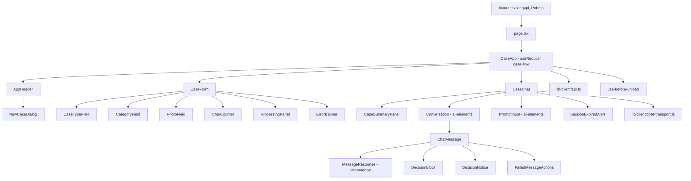
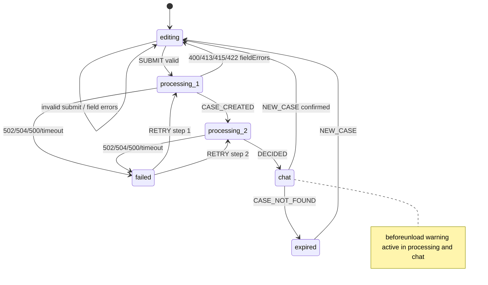
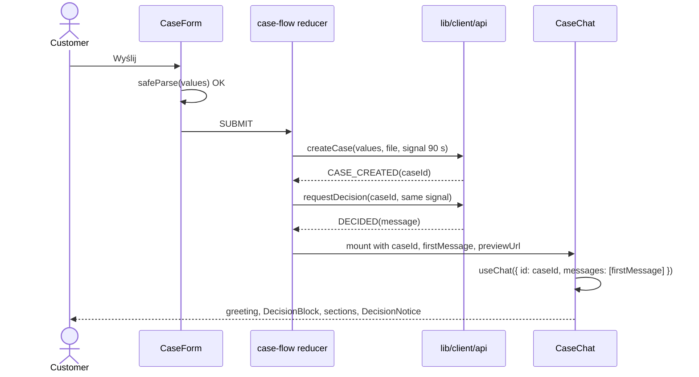
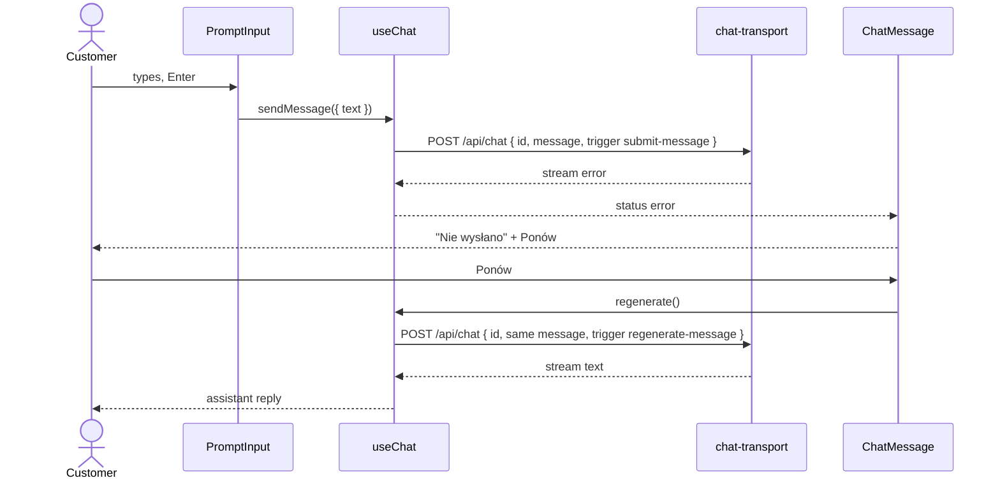

# ADR-003: Frontend — Screens, Chat UI, Client State and Design Tokens

**Date:** 2026-11-25
**Status:** Accepted
**Relates to:** `docs/ADR/000-main-architecture.md`, `docs/ADR/002-backend-api.md`, PRD sections 4, 6 (AC-01 – AC-15, AC-29 – AC-45), 9; `docs/design-guidelines.md`

---

## 1. Scope

This ADR covers:
- the client application: the form screen, processing state and chat screen, plus the new-case dialog;
- client-side validation and client state;
- the `useChat` integration with our backend contract;
- the chat UI components;
- mapping the Eurocash design tokens to Tailwind/shadcn;
- accessibility and frontend tests.

HTTP contracts are in 002, and message content and decision semantics are in 001.

---

## 2. Technology Documentation References

| Library | Context7 ID or official docs | Used for |
|---|---|---|
| AI SDK UI v7 (`@ai-sdk/react@^4`) | `/vercel/ai` (`07-reference/02-ai-sdk-ui/01-use-chat.mdx`, `04-ai-sdk-ui/03-chatbot-message-persistence.mdx`, `04-ai-sdk-ui/21-error-handling.mdx`) | `useChat`, `DefaultChatTransport`, `prepareSendMessagesRequest`, `status`, `regenerate`, typed `UIMessage` parts |
| shadcn AI components / AI Elements | <https://ui.shadcn.com/docs/ai-elements>; `/vercel/ai-elements` | Conversation/Chat, Message, MessageContent, MessageResponse, Prompt Input, Shimmer |
| shadcn/ui | <https://ui.shadcn.com/docs> | Button, Input, Textarea, Select, RadioGroup, Label, Alert, AlertDialog, Badge, Card, Collapsible, Dialog |
| Streamdown | <https://streamdown.ai> | Streaming markdown inside `MessageResponse` |
| Tailwind CSS 4 | <https://tailwindcss.com/docs/theme> | `@theme` tokens in `globals.css` |
| Next.js 16 | `/vercel/next.js/v16.4.5` | `next/font/google` (Roboto, `latin-ext` subset), App Router layout and metadata |
| lucide-react | <https://lucide.dev> | Icons (installed by shadcn) |
| Testing Library | <https://testing-library.com/docs/react-testing-library/intro> | Component tests |
| Playwright | <https://playwright.dev/docs/intro> | E2E, screenshots, manual QA |

**Verified facts this ADR relies on (2026-11-25):**
- `useChat` returns `status` (`submitted` | `streaming` | `ready` | `error`), `error`, `sendMessage`, `regenerate`, `stop`, `clearError` and `setMessages`.
- `useChat` accepts `id` and initial `messages`.
- `DefaultChatTransport` accepts `api` and `prepareSendMessagesRequest`.
- `PromptInput` supports `onSubmit(message)`. With no attachment components rendered it sends text only.
- `MessageResponse` renders markdown through Streamdown, which needs a `@source` line in `globals.css`.
- The AI Elements `image` component has no shadcn replacement, so a plain `` is used.

---

## 3. Component Design

### 3.1 Files

```
src/app/layout.tsx              <html lang="pl">, Roboto (latin + latin-ext, 300–700), metadata title
src/app/page.tsx                Renders <CaseApp/> (client component)
src/components/app-header.tsx   Logo + product name; "Nowa sprawa" slot (chat screen only)
src/components/case-app.tsx     Owns the flow reducer and switches screens
src/components/case-form/
  case-form.tsx                 Form layout, submit handler, focus management
  case-type-field.tsx           Two-option RadioGroup, styled as a segmented control
  category-field.tsx            Select with the 8 categories
  photo-field.tsx               Drop zone + hidden file input + preview + change/remove
  char-counter.tsx              Code-point counter "n / 2000"
  processing-panel.tsx          Two-step progress (aria-live)
  error-banner.tsx              Alert + "Spróbuj ponownie"
src/components/case-chat/
  case-chat.tsx                 useChat wiring, layout (summary + conversation + input)
  case-summary-panel.tsx        Case data + thumbnail; collapsible on mobile
  chat-message.tsx              Renders one CaseUIMessage by parts
  decision-block.tsx            Outcome block (initial / updated variant)
  decision-notice.tsx           Mandatory AC-41 notice
  failed-message-actions.tsx    "Nie wysłano" + "Ponów"
  new-case-dialog.tsx           AlertDialog confirmation
  session-expired-alert.tsx     "Sesja wygasła" + "Nowa sprawa"
src/components/ai-elements/     Installed chat components (TD-03)
src/components/ui/              Installed shadcn primitives
src/lib/client/
  api.ts                        createCase, requestDecision, deleteCase → typed ApiError(code, messagePl, fieldErrors)
  case-flow.ts                  Pure reducer + action types (unit-tested)
  chat-transport.ts             DefaultChatTransport factory with prepareSendMessagesRequest + error-aware fetch
  use-before-unload.ts          Registers the leave-page warning while a case is open
```

### 3.2 Client state machine (`case-flow.ts`)

All state lives in React memory. There is no `localStorage`, `sessionStorage` or cookie, so a reload always starts empty (AC-37).

| State | Data | Screen | Leave-page warning |
|---|---|---|---|
| `editing` | `values`, `file`, `previewUrl`, `fieldErrors` | Form | No |
| `processing` | + `step` (1\|2), `caseId?`, `deadline` | Form (locked) + ProcessingPanel | Yes |
| `failed` | + `failedStep` (1\|2), `caseId?`, `error` | Form (unlocked, values kept) + ErrorBanner | Yes when `caseId` is set (step-2 failure), otherwise no |
| `chat` | `caseId`, `form`, `previewUrl`, `firstMessage` | Chat | Yes |
| `expired` | as `chat` + flag | Chat + SessionExpiredAlert, input disabled | No |

**Transitions:**
- `SUBMIT` (client validation OK) → `processing` step 1.
- `CASE_CREATED(caseId)` → step 2.
- `DECIDED(message)` → `chat`.
- `FAILED(step, error)` → `failed`. Field-level errors (400/413/415/422) go back to `editing` with `fieldErrors` set, not to the banner.
- `RETRY`:
  - from `failed` step 1 → `processing` step 1 (resubmits the kept values and file);
  - from `failed` step 2 → `processing` step 2 (same `caseId`; on 404 it falls back to step 1).
- `SESSION_EXPIRED` → `expired`.
- `NEW_CASE` → `editing` with empty values. It revokes the preview object URL and calls `deleteCase` fire-and-forget.

**90 s budget (AC-28):** one `AbortController` is created on `SUBMIT`. Its signal is combined with a 90 000 ms timeout and passed to both requests. When the timeout fires, the reducer gets `FAILED(step, AI_TIMEOUT)` and the PRD message "Nie udało się przygotować decyzji. Spróbuj ponownie za chwilę." is shown.

### 3.3 Form screen (PRD 9.2)

**Validation:**
- Uses the shared `CaseFormInput` Zod schema from `lib/shared/schemas` and the same Polish messages as the server.
- Runs on blur of each field and on submit. A field's error clears as soon as it becomes valid.

**On an invalid submit (AC-14):**
- No request is sent.
- `aria-invalid` and `aria-describedby` are set on every invalid field.
- The first invalid field in DOM order is focused and scrolled into view.

**Fields** (in the AC-01 order):

| Field | Control | Notes |
|---|---|---|
| Case type | RadioGroup with 2 items "Reklamacja" / "Zwrot" | Nothing selected initially (AC-02). Changing it updates the description label "(opcjonalnie)", whether the description is required, and the description and photo hints (PRD 9.2). |
| Category | Select, placeholder "Wybierz kategorię" | Polish labels from AC-03, mapped to the enum values in 002 4.1 |
| Model name | Input, placeholder "np. Lenovo ThinkPad E14 Gen 5" | `maxLength` 100 |
| Purchase date | Native `<input type="date">`, styled with the shadcn Input, `min="2000-01-01"`, `max` = today in Europe/Warsaw | The native picker is used (TD-301) |
| Description | Textarea + `CharCounter` ("125 / 2000", AC-08) | Counts code points, the same as the server |
| Photo | `PhotoField` | Details below |

**PhotoField:**
- A hidden `<input type="file" accept="image/jpeg,image/png,image/webp">` **without** the `capture` attribute. Phones then offer both the camera and the gallery (AC-13).
- On desktop: a click-to-choose area that also accepts drag and drop.
- Before the file is accepted, the client checks size (10 485 760 bytes) and MIME type and shows the AC-10/AC-11 messages.
- Preview with `URL.createObjectURL`. The URL is revoked when the photo is replaced, removed or a new case starts.
- Shows the file name and the "Zmień zdjęcie" / "Usuń" actions (AC-12).

**Other elements:**
- The AI notice (AC-42) is static text above the submit button.
- The submit button "Wyślij" is the primary (orange) variant.
- While processing (AC-15):
  - every input is `disabled`;
  - the submit button is replaced by `ProcessingPanel` with "Analizuję zdjęcie…" and "Przygotowuję decyzję…";
  - the steps are pending, active (spinner icon + `aria-current="step"`) or done (check icon);
  - the panel is wrapped in `aria-live="polite"`.
- `ErrorBanner` is an Alert above the form with the error's `messagePl` and a "Spróbuj ponownie" button. It receives focus when shown.

### 3.4 Chat screen (PRD 9.3)

**Layout:**
- **At 1024 px and wider:** a two-column grid. `CaseSummaryPanel` is about 320 px wide and sticky; the conversation takes the rest.
- **Below 1024 px:** `CaseSummaryPanel` becomes a `Collapsible` bar "Szczegóły sprawy ▾", collapsed by default.
- The conversation fills the height with the input pinned to the bottom. There is no horizontal overflow at 360 px (AC-44).

**`CaseSummaryPanel`** (AC-31):
- Shows the case type badge, category label, model, purchase date in `dd.mm.rrrr` format, and the description truncated to 200 code points with a "pokaż więcej"/"pokaż mniej" toggle.
- The thumbnail comes from the client-side `previewUrl`; the server never returns the image. Clicking it opens a `Dialog` with a larger preview.

**`useChat` wiring** (`case-chat.tsx` + `chat-transport.ts`):
- `useChat<CaseUIMessage>({ id: caseId, messages: [firstMessage], transport })`.
- The transport is a `DefaultChatTransport` with:
  - `api: '/api/chat'`;
  - `prepareSendMessagesRequest` → body `{ id, message: messages.at(-1), trigger }` (002 5.3);
  - a custom `fetch` wrapper. For non-2xx JSON responses it throws an `ApiError` with the server `code`, so the UI can tell `CASE_NOT_FOUND` (→ `SESSION_EXPIRED`), `CASE_BUSY` and `CHAT_LIMIT` apart from generic failures.
- If the installed `useChat` version accepts data part schemas, pass the Zod schema for `data-decision` (check the option name in `/vercel/ai`).

**Message rendering** (`chat-message.tsx`). Parts are rendered in their stored order:

| Part | Rendering |
|---|---|
| assistant `text` | `MessageResponse` (Streamdown markdown: headings, bold, lists; AC-30). Raw HTML rendering is disabled and images in markdown are not rendered. |
| user `text` | Plain text with preserved line breaks. Not rendered as markdown. |
| `data-decision` | `DecisionBlock` variant `initial` |
| `tool-updateDecision` in state `output-available` with `output.accepted = true` | `DecisionBlock` variant `updated`, heading "Zaktualizowana wstępna decyzja" |
| `tool-updateDecision` in another state, or not accepted | Nothing visible. While in progress, a `Shimmer` "Aktualizuję decyzję…" |

After the last part of any assistant message that contains a rendered `DecisionBlock`, render `DecisionNotice` with the exact AC-41 text (001 TD-103).

**Alignment and time:**
- Assistant messages are left-aligned with an assistant avatar or label "Asystent"; user messages are right-aligned.
- Each message shows `HH:MM` from `metadata.createdAt`. When a message has no `createdAt`, the time is taken from a client-side map filled when the message id first appears.

**`DecisionBlock`:**
- A highlighted card. The outcome is shown by an icon **and** a text label **and** a color, never color alone (PRD 9.3):

| Outcome | Icon | Color |
|---|---|---|
| ACCEPT | check-circle | green |
| REJECT | x-circle | red |
| MANUAL_REVIEW | alert-triangle | orange |

- Shows the remedy label (001 §4) and "Podstawa: R-x.y, …".

**Input:**
- The `PromptInput` textarea grows up to 5 lines, then scrolls.
- Enter sends; Shift+Enter adds a new line (AC-32).
- Submit is disabled when the trimmed text is empty, the text is over 2000 code points, or `status` ≠ `ready`/`error`.
- A counter appears above 1800 code points.
- There are no attachment actions (AC-36).

**Status UI:**
- `submitted` / `streaming`: the input is disabled and an "Asystent pisze…" `Shimmer` shows below the last message (AC-33). The conversation auto-scrolls to the newest message unless the user has scrolled up.
- `error`:
  - the last user message gets `FailedMessageActions` ("Nie wysłano" + "Ponów", AC-35);
  - "Ponów" calls `regenerate()`, which resends the same message id with `trigger: regenerate-message`;
  - check in `/vercel/ai` that `regenerate()` resends the last user message when no assistant reply exists. If it does not, call `clearError()`, then `sendMessage` with the same `messageId`.
- `ApiError` `CASE_NOT_FOUND` → the `expired` state: `SessionExpiredAlert` "Sesja wygasła. Rozpocznij nową sprawę." with a "Nowa sprawa" button, and the input is disabled.

**`NewCaseDialog`** (AC-39, PRD 9.4):
- An AlertDialog with the text "Rozpocząć nową sprawę? Obecna rozmowa zostanie usunięta." and two buttons:
  - "Anuluj" (secondary) closes the dialog and changes nothing;
  - "Nowa sprawa" (primary) dispatches `NEW_CASE`.
- If a chat stream is in progress, `stop()` is called first.

**Leave-page warning (AC-38):** `use-before-unload` registers a `beforeunload` handler with `preventDefault()` while the state is `processing` or `chat`.

### 3.5 Design tokens (Eurocash brand, AC-45)

`globals.css` defines the shadcn CSS variables and the Tailwind `@theme` tokens from `assets/design-tokens.json`. There is no dark mode (it isn't in the brand reference).

| shadcn / theme variable | Token | Value |
|---|---|---|
| `--background` / `--card` / `--popover` | `background.default` | `#FFFFFF` |
| `--foreground` | `text.primary` | `#3D4455` |
| `--primary` / `--primary-foreground` | `brand.accent` / `text.onDark` | `#E67741` / `#FFFFFF` (CTA: "Wyślij", "Nowa sprawa" in the dialog) |
| `--secondary` / `--secondary-foreground` | `brand.buttonGreen` / `text.onDark` | `#358F42` / `#FFFFFF` |
| `--muted` / `--muted-foreground` | `background.light` / `text.muted` | `#EDEDED` / `#6B7280` |
| `--destructive` | `brand.logoRed` | `#EE3042` |
| `--ring` | `brand.primary` | `#01983D` |
| `--success` (custom) | `brand.primary` | `#01983D` |
| link color | `text.link` | `#01983D` |
| font | Roboto | 300/400/500/600/700, subsets `latin` + `latin-ext` (Polish diacritics) |
| button radius | `radius.leaf` | `10px 0px`, as a `rounded-leaf` utility applied to the Button variants |
| input radius | `radius.md` | `8px` |
| spacing | 4 px grid | Tailwind default scale |

**Header and footer:**
- The header has a white background. On the left is a text wordmark: "Hardware Service Decision Copilot" in `text.primary` 18 px/600, with "Example Electronics Store" below it in `text.muted` 13 px. On the right is "Nowa sprawa" (secondary, green). No Eurocash logo, favicon or name is used anywhere (PRD AC-45).
- The 35 px green sidebar strip from the reference is shown only at 1024 px and wider.
- There is no footer.

**DecisionBlock colors:** tinted backgrounds (green, red or orange at about 10 % opacity) with a 4 px left border in the full color. The text stays `text.primary`, so contrast stays ≥ 4.5:1.

---

### 3.6 UI selector contract (accessible names and test ids)

Decided by the orchestrator on 2026-11-26 so that the E2E specs (T06) and the components (T12, T13, T14, T22) use the same names. E2E tests select by role and accessible name; `data-testid` is used only where no accessible name fits. Texts come from `lib/shared/strings`.

| Element | Role / selector | Accessible name or text |
|---|---|---|
| Case type | `radiogroup` with 2 `radio` | group "Rodzaj zgłoszenia"; radios "Reklamacja", "Zwrot" |
| Category | `combobox` (Radix Select), options `option` | "Kategoria sprzętu"; options = AC-03 labels |
| Model name | `textbox` | "Nazwa lub model urządzenia" |
| Purchase date | date input, label | "Data zakupu" |
| Description | `textbox` (textarea) | starts with "Opis"; return variant "Opis (opcjonalnie)" |
| Photo | file input, label | "Zdjęcie urządzenia" (Playwright `setInputFiles` on the labelled input) |
| Submit | `button` | "Wyślij" |
| Field error | text linked by `aria-describedby` | exact `lib/shared/strings` message |
| Processing steps | text | "Analizuję zdjęcie…", "Przygotowuję decyzję…" |
| Error banner | `alert` + `button` | message + "Spróbuj ponownie" |
| Header action | `button` | "Nowa sprawa" |
| New-case dialog | `alertdialog`, buttons | "Rozpocząć nową sprawę? Obecna rozmowa zostanie usunięta."; "Anuluj", "Nowa sprawa" |
| Case summary | `region` | "Szczegóły sprawy" |
| Chat message | `[data-testid="chat-message"]` with `data-role="assistant"` or `"user"` | — |
| Decision block | `[data-testid="decision-block"]` with `data-outcome="ACCEPT"`, `"REJECT"` or `"MANUAL_REVIEW"` | outcome label (AC-20) and "Podstawa: R-x.y, …" |
| Decision notice | text | AC-41 notice |
| First-message sections | `heading` | "Co widzimy na zdjęciu", "Uzasadnienie", "Kolejne kroki", "Pytania do Ciebie" |
| Chat input / send | `textbox`, `button` | "Wiadomość"; "Wyślij" |
| Typing indicator | text | "Asystent pisze…" |
| Failed message | text + `button` | "Nie wysłano"; "Ponów" |
| Session expired | `alert` | "Sesja wygasła. Rozpocznij nową sprawę." |

## 4. Data Structures

| Structure | Fields | Notes |
|---|---|---|
| `FormValues` | `caseType?`, `category?`, `modelName`, `purchaseDate`, `description` | Before validation; becomes `CaseFormInput` |
| `FieldErrors` | `Partial<Record<field \| 'image', errorCode>>` | Polish text is resolved through `lib/shared/strings` |
| `ApiError` | `status`, `code`, `messagePl`, `fieldErrors?` | Thrown by `lib/client/api.ts` and the chat fetch wrapper |
| `FlowState` | union of the states in 3.2 | Reducer state |
| `CaseUIMessage` | shared type (001 §4) | Used for `useChat` generics |

---

## 5. Interface Contracts (client → server)

| Client function | Request | Success | Failure handling |
|---|---|---|---|
| `createCase(values, file, signal)` | `POST /api/cases` multipart | `{ caseId }` | 400/413/415/422 → `fieldErrors` on the form. 502/504/500/abort → banner (step 1). |
| `requestDecision(caseId, signal)` | `POST /api/cases/{caseId}/decision` | `{ message }` | 404 → retry from step 1. 409 → wait 1 s and retry once. 502/504/500/abort → banner (step 2). |
| `deleteCase(caseId)` | `DELETE /api/cases/{caseId}` with `keepalive: true` | `204` | Errors are ignored |
| `useChat` transport | `POST /api/chat` `{ id, message, trigger }` | UI message stream | See 3.4 status UI |

---

## 6. Technical Decisions

### TD-301 Native date input instead of a calendar popover
**Status:** Accepted
**Date:** 2026-11-25
**Context:** The PRD asks for a date picker with future dates disabled (AC-05, 9.2), usable on phones.
**Decision:** `<input type="date">` with `min` and `max`, styled like the other inputs. `lang="pl"` on `<html>` gives the Polish locale in browsers that honour it.
**Rejected alternatives:** The shadcn Calendar + Popover (react-day-picker): an extra dependency and locale setup, and weaker mobile UX than native pickers.
**Consequences:** (+) Accessible, mobile-native and zero dependencies. (-) The display format depends on the browser locale.
**Review trigger:** Manual QA finds a target browser showing a non-Polish format that confuses testers.

### TD-302 Plain controlled form with the shared Zod schema (no form library)
**Status:** Accepted
**Date:** 2026-11-25
**Context:** Six fields, one conditional rule, and the same schema on client and server.
**Decision:** A `useReducer`-managed form state and `schema.safeParse` on blur and submit, with error codes mapped to the shared Polish strings.
**Rejected alternatives:** react-hook-form + resolvers: an extra dependency and a docs lookup for little gain at this size.
**Consequences:** (+) Minimal code that is easy to unit-test. (-) Focus management and touched state are written by hand.
**Review trigger:** The form grows beyond about 10 fields or gets multi-step.

### TD-303 Direct `useChat` + shadcn AI components rather than a chat runtime
**Status:** Accepted
**Date:** 2026-11-25
**Context:** We need a seeded first message, custom `data-decision` and tool parts, the `caseId` in every request, typed errors and a per-message retry.
**Decision:** Use `useChat` directly with a custom transport and render the parts ourselves inside the installed `Conversation`/`Message`/`MessageResponse`/`PromptInput` components.
**Rejected alternatives:** assistant-ui `useChatRuntime` + `Thread`: its message rendering pipeline would need custom part renderers and a custom transport anyway (000 TD-02).
**Consequences:** (+) Full control and a thin abstraction. (-) Auto-scroll and the failed-message UI are our own code.
**Review trigger:** Adding features assistant-ui provides for free, such as branching, edit and resend, or a thread list.

### TD-304 The image preview stays client-side
**Status:** Accepted
**Date:** 2026-11-25
**Context:** The chat summary needs a thumbnail (AC-31), and the server discards the image after the decision (002).
**Decision:** The preview uses the object URL of the original file, held in client state until a new case starts or the page reloads.
**Rejected alternatives:** A server endpoint returning the processed image (it would mean retaining images on the server).
**Consequences:** (+) No image retention on the server. (-) After a reload there is nothing to show, which is consistent with AC-37.
**Review trigger:** Session persistence is added.

---

## 7. Diagrams

### Component diagram



### State diagram



### Sequence: submit to first chat bubble (client view)



### Sequence: chat failure and retry (client view)



---

## 8. Testing Strategy

Component tests use Vitest + Testing Library (jsdom), with `fetch` and `useChat` transports stubbed by **recorded** server responses: a real `DecisionResponse` and a real UI message stream captured from the running app with synthetic data, stored in `tests/fixtures/recorded/`. E2E uses Playwright against `npm run build && npm start` and the real OpenRouter, with `assets/example-images/*`. Manual QA follows AGENTS.md: Playwright CLI screenshots of every screen and state, compared with `assets/homepage.png` and `docs/design-guidelines.md`.

### Test scenarios for this area

| Scenario | Type | Input | Expected output | Edge cases |
|---|---|---|---|---|
| Field order and defaults | Component | render form | labels in the AC-01 order; no case type or category selected | — |
| Conditional description | Component | toggle Reklamacja ↔ Zwrot | "(opcjonalnie)" only for Zwrot; 19 chars invalid only for Reklamacja | switching back keeps the typed text |
| Counter | Component | type text with emoji | "n / 2000" counts code points | paste 2500 chars → error `DESCRIPTION_MAX` |
| Photo rejection | Component | 11 MB PNG; `photo.heic` | AC-11 / AC-10 messages, no preview | the exact 10 485 760 B file is accepted |
| Invalid submit | Component | empty form, Wyślij | no `fetch` call; 5 error messages; focus on Case type | only the photo missing → focus on the photo field |
| Locked form | Component | valid submit with a pending fetch | all inputs disabled; ProcessingPanel step 1 active | — |
| Step-2 failure retry | Component | createCase OK, decision 502, then OK | banner shown, values kept; retry calls only `/decision` | 404 on retry → full resubmit |
| 90 s timeout | Component (fake timers) | fetch never resolves | after 90 000 ms the banner shows the AC message | — |
| First message rendering | Component | recorded `DecisionResponse` per outcome | order: greeting, DecisionBlock, sections, notice (AC-29, AC-41) | MANUAL_REVIEW shows "Pytania do Ciebie" |
| Markdown | Component | assistant text with `**bold**`, `#`, list | no literal `**` or `#` in the DOM text (AC-30) | `<script>` in the text is not executed or rendered as HTML |
| Updated decision | Component | message with an accepted `tool-updateDecision` output | DecisionBlock "Zaktualizowana wstępna decyzja" + notice | `accepted: false` → no block, no notice |
| Chat input rules | Component | whitespace; 2001 chars; Shift+Enter | send disabled; disabled; newline inserted | Enter while streaming → nothing sent |
| Failed message | Component | transport error | "Nie wysłano" + "Ponów"; Ponów resends the same message id | `CASE_NOT_FOUND` → SessionExpiredAlert |
| New case dialog | Component | Nowa sprawa → Anuluj / → confirm | unchanged / empty form, `DELETE` called, object URL revoked | — |
| Reducer | Unit | every transition in the state diagram | correct next state; illegal transitions ignored | double SUBMIT ignored while processing |
| Happy return E2E | E2E | Zwrot, Laptop, today − 5 days, `laptop-1.png` | chat screen ≤ 90 s; DecisionBlock + notice; follow-up question "Jaki model zgłosiłem?" answered with the model name (AC-34) | — |
| Happy complaint E2E | E2E | Reklamacja, Smartfon, today − 300 days, `phone-1.jpg`, 40-char description | decision with a C-rule citation | — |
| Mismatch E2E | E2E | Laptop category + `phone-2.jpeg` | "Wymaga weryfikacji przez serwis" and the message mentions the phone | — |
| Reload and leave warning | E2E | reload in chat | the `beforeunload` dialog appears; after accepting, an empty form | — |
| Responsive | E2E | viewports 360×740 and 1920×1080 on both screens | `document.documentElement.scrollWidth ≤ innerWidth` (AC-44); summary collapsible at 360 | — |
| Polish UI | E2E | scan visible text on both screens | no English UI strings from a deny-list ("Submit", "Send", "Loading", "Error") | — |

### Technical acceptance criteria

- **TAC-003-01** No `localStorage`, `sessionStorage`, `indexedDB` or `document.cookie` usage in `src/` (checked by grep in CI/lint).
- **TAC-003-02** Every interactive element on both screens is reachable by keyboard. Form errors are announced: each invalid field has `aria-invalid="true"` and `aria-describedby` pointing to its message.
- **TAC-003-03** Every Polish UI string lives in `lib/shared/strings/` (`common.ts`, `form.ts`, `chat.ts`), and components contain no hard-coded user-facing literals (lint rule or review checklist).
- **TAC-003-04** Lighthouse accessibility score ≥ 90 on both screens (manual QA run).
- **TAC-003-05** The client bundle does not import from `src/server` (enforced by `server-only`; the build fails otherwise).
- **TAC-003-06** Manual QA screenshots of the form (empty, errors, processing, failed), the chat (accept, reject, manual review, updated decision, failed message, expired) and the dialog are attached to the task summary at 360 px and 1440 px widths.

### Known trade-off

White text on the brand orange `#E67741` CTA has a contrast ratio below 4.5:1 for 16 px/600 text. The brand reference is followed as AC-45 requires, and the issue is recorded for the design owner. Changing it is a brand decision, not an implementation one.

The same applies to white text on `brand.buttonGreen` `#358F42` (4.07:1), used by the **Nowa sprawa** button and the case-type badge. T25 measured both with axe-core; the human accepted them as brand trade-offs on 2026-11-27 (QA finding F-08).
